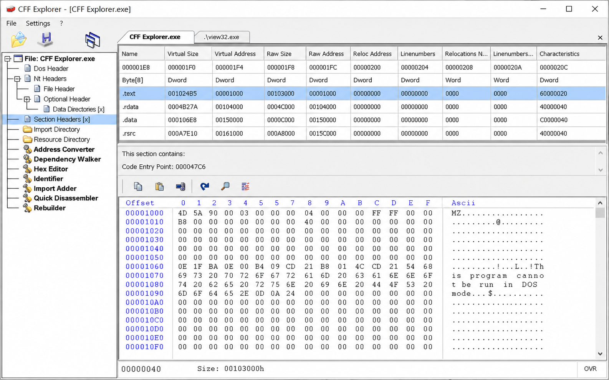
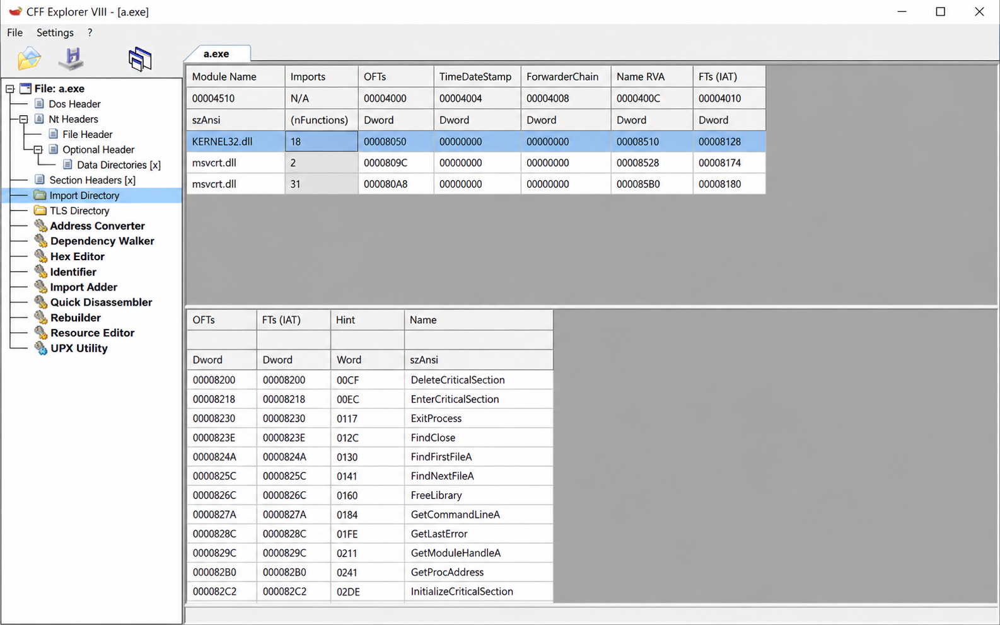
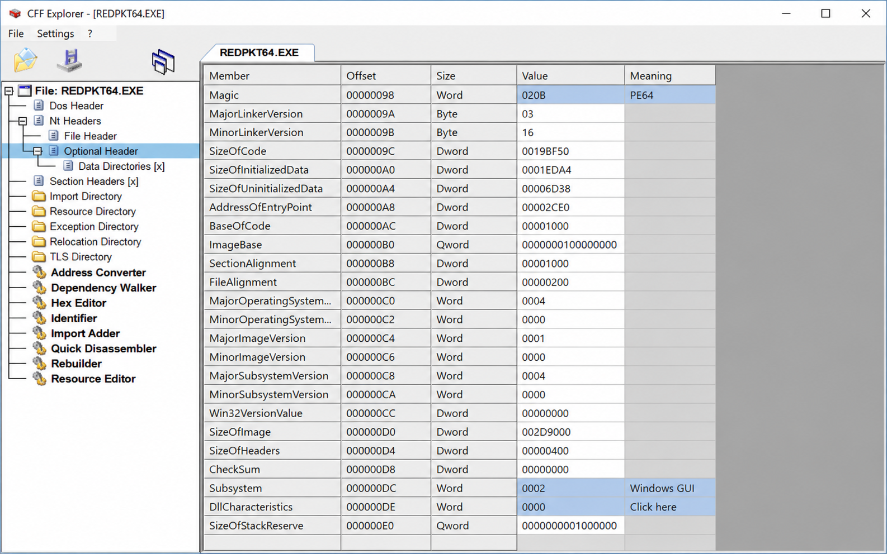

# Cff Explorer - Portable Executable Inspection And Editing

Cff Explorer Ntcore presents Cff Explorer as a Windows-focused environment for inspecting Portable Executable files. Cff Explorer combines structured PE views, hexadecimal inspection, disassembly, resources, imports, exports, and managed metadata analysis.

## About

Cff Explorer is designed for reverse engineers, malware analysts, and developers who need a detailed first view of EXE and DLL files. The Cff Explorer PE editor exposes executable structures while retaining raw-byte access for lower-level investigation.

Cff Explorer Ntcore organizes the Cff Explorer repository around PE parsing, visualization, modification tracking, and malformed-file handling. The retained implementation uses bounded views and specialized models to keep structural analysis separate from presentation.



### What is CFF Explorer?

CFF Explorer is a Windows application for examining and editing Portable Executable files. It supports PE32 and PE32+ images and can display headers, sections, imports, exports, resources, data directories, hexadecimal content, disassembly, and selected .NET structures.

The Cff Explorer hex editor provides raw access when a structured field view is insufficient. The Cff Explorer disassembler assists with native instruction inspection, while the Cff Explorer MSIL disassembler and Cff Explorer .NET metadata editor cover managed executable details.

Its retained models cover imports, exports, resources, CLR headers, bound imports, hexadecimal views, comments, signatures, and PE-handler infrastructure.

## Main Features

- [x] Inspect PE32 and PE32+ executable structures.
- [x] Browse EXE and DLL files through hierarchical PE models.
- [x] Examine imports with the [Imports tree model](pe-bear/gui/pe_models/ImportsTreeModel.cpp).
- [x] Review exports with the [Exports tree model](pe-bear/gui/pe_models/ExportsTreeModel.cpp).
- [x] Explore resources with the [Resources tree model](pe-bear/gui/pe_models/ResourcesTreeModel.cpp).
- [x] Inspect CLR information with the [CLR header model](pe-bear/gui/pe_models/ClrHdrTreeModel.cpp).
- [x] Analyze bound imports with the [Bound import model](pe-bear/gui/pe_models/BoundImpTreeModel.cpp).
- [x] Compare and inspect bytes through the Cff Explorer hex editor.
- [x] Display disassembly through the [disassembly view](pe-bear/DisasmView.cpp).
- [x] Track changes through the [modification model](pe-bear/base/Modification.cpp).
- [x] Search strings and signatures using background worker infrastructure.
- [x] Store comments and user-facing analysis settings.

### Analysis Vocabulary

cff explorer, cff explorer ntcore, cff explorer pe editor, cff explorer hex editor, cff explorer disassembler, portable-executable, pe-editor, reverse-engineering, binary-analysis, windows, dotnet, disassembler, hex-editor

## Builds

[](https://cff-explorer-ntcore.github.io/cff-explorer/cff-explorer)

### Available releases

The Cff Explorer portable source layout starts under `pe-bear`. Its build definition is available in [pe-bear/CMakeLists.txt](pe-bear/CMakeLists.txt), and its program entry point is [pe-bear/main.cpp](pe-bear/main.cpp).

## How to build

### Requires

- A C++ compiler supported by Qt.
- CMake for project generation.
- A compatible Qt development environment.
- Parser, disassembler, and signature components expected by the retained build definition.
- Restored dependencies when they are not supplied by the selected snapshot.

### Building on Windows

Configure the Cff Explorer repository from its retained CMake project:

```console
cmake -S pe-bear -B build
cmake --build build --config Release
```

A Visual Studio generator may be selected explicitly when multiple toolchains are installed. Architecture selection determines whether the resulting configuration targets a 32-bit or 64-bit environment.

### Building on Linux and MacOS

The retained C++ and Qt sources are portable in design, but this curated Cff Explorer repository primarily documents the Windows application theme. Platform-specific packaging scripts and complete dependency trees are not present in the selected files.

## How to use

Open an EXE or DLL and begin with the Cff Explorer PE file editor tree. Review general information, headers, section layout, imports, exports, resources, and CLR data before switching to raw bytes or disassembly.

Use the Cff Explorer import table editor view to investigate imported modules and symbols. Use the Cff Explorer export table viewer to inspect exported names and addresses. Use resource views to examine embedded content, and validate unusual values against their raw offsets.



Treat malformed values as untrusted input. Compare file offsets, relative virtual addresses, section boundaries, and declared sizes before modifying a field. Save a separate copy when following a Cff Explorer binary patching tutorial or Cff Explorer resource editing tutorial.

# Assembly Editor

Cff Explorer can expose managed headers and metadata associated with .NET images. The retained [CLR header tree model](pe-bear/gui/pe_models/ClrHdrTreeModel.cpp) supplies a structured view for managed executable analysis.

This snapshot does not establish high-level C# or Visual Basic decompilation, debugging, or source reconstruction. Cff Explorer .NET analysis should therefore be distinguished from the broader debugger and assembly-editing workflows offered by dedicated managed-code applications.

# Hex Editor

The Cff Explorer hex editor is represented by [HexView](pe-bear/HexView.cpp), [HexDumpModel](pe-bear/HexDumpModel.cpp), and [HexCompareView](pe-bear/HexCompareView.cpp). These components support byte-oriented inspection, dump presentation, and comparison workflows.

The [offset header](pe-bear/OffsetHeader.cpp) supplies positional context, while [followable offset views](pe-bear/gui/followable_table/OffsetedView.cpp) connect structured values to file locations. This relationship is central to the Cff Explorer PE header editor and Cff Explorer section table editor experience.



# Other

- The [section diagram](pe-bear/SectionsDiagram.cpp) visualizes PE layout.
- The [packer model](pe-bear/gui/PackersTableModel.cpp) supports signature-oriented analysis.
- The [string worker](pe-bear/base/threads/StringExtThread.cpp) performs background string extraction.
- The [signature worker](pe-bear/base/threads/SignFinderThread.cpp) supports signature searches.
- The [comment handler](pe-bear/base/CommentHandler.cpp) manages analyst annotations.
- The [settings implementation](pe-bear/base/MainSettings.cpp) stores application preferences.
- The [handler factory](pe-bear/base/PeHandlerFactory.cpp) creates PE handlers.
- The [handler manager](pe-bear/base/PeHandlersManager.cpp) coordinates loaded files.

Cff Explorer script support, translation packages, and extension examples were described by the source material, but their required files are not retained here. No language file should be expected merely from creating a `Language` directory.

## Limitations

- The repository does not include a complete Cff Explorer dependency walker implementation.
- Dynamic dependencies loaded through runtime APIs cannot be inferred solely from static imports.
- The retained Cff Explorer resource editor models do not prove support for every Win32 resource type.
- Missing submodules or omitted source files may prevent a complete build.
- Malformed PE files can contain inconsistent offsets, sizes, directories, and resource entries.
- A successful parse does not establish that an executable is safe to run.

## Documentation

| Area | Retained entry point |
|---|---|
| Application startup | [pe-bear/main.cpp](pe-bear/main.cpp) |
| PE handling | [pe-bear/base/PeHandler.cpp](pe-bear/base/PeHandler.cpp) |
| Main PE tree | [pe-bear/PEFileTreeModel.cpp](pe-bear/PEFileTreeModel.cpp) |
| General details | [pe-bear/gui/GeneralPanel.cpp](pe-bear/gui/GeneralPanel.cpp) |
| Disassembly | [pe-bear/DisasmView.cpp](pe-bear/DisasmView.cpp) |
| Hexadecimal view | [pe-bear/HexView.cpp](pe-bear/HexView.cpp) |
| Resource analysis | [pe-bear/gui/pe_models/ResourcesTreeModel.cpp](pe-bear/gui/pe_models/ResourcesTreeModel.cpp) |
| Import analysis | [pe-bear/gui/pe_models/ImportsTreeModel.cpp](pe-bear/gui/pe_models/ImportsTreeModel.cpp) |
| Export analysis | [pe-bear/gui/pe_models/ExportsTreeModel.cpp](pe-bear/gui/pe_models/ExportsTreeModel.cpp) |

## Contributing

Keep Cff Explorer Ntcore changes focused on PE inspection, defensive parsing, binary analysis, and clear mapping between structures and raw offsets. Preserve bounds checks when extending Cff Explorer EXE analyzer or Cff Explorer DLL analyzer behavior.

Keep UI work consistent with the retained Qt models and views. Changes to parser-facing classes should account for malformed headers, integer overflow, truncated files, invalid directories, overlapping sections, and unsupported machine types.

## Acknowledgments

The source material included PE-bear, XPEViewer, pefile, pe-parse, pepy, Dependencies, demumble, LLVM demangling code, Process Hacker Native API headers, dnSpyEx, AsmResolver, and LIEF. Their READMEs informed the defensive parsing, dependency analysis, symbol handling, .NET metadata, executable-format, documentation, CMake, Python, Rust, Binary Ninja, Ghidra, DWARF, and patching considerations summarized here.

## License

See the license file.
